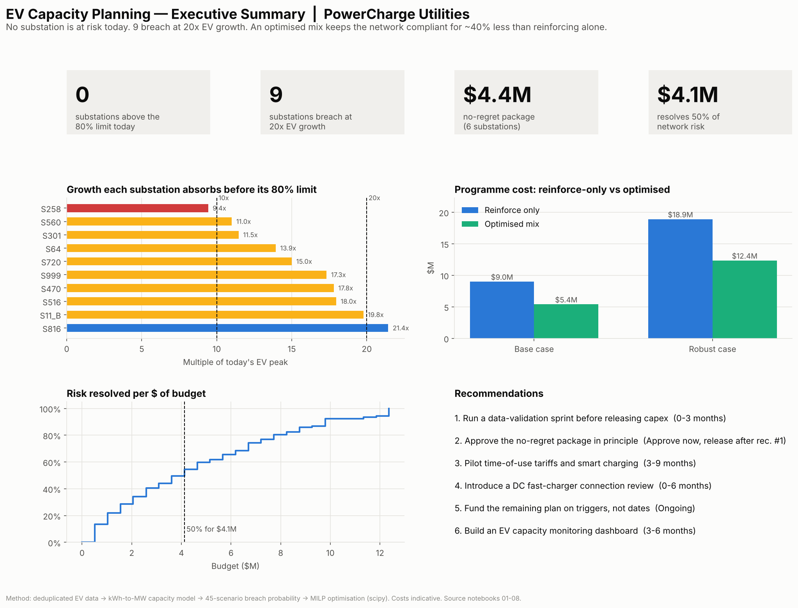
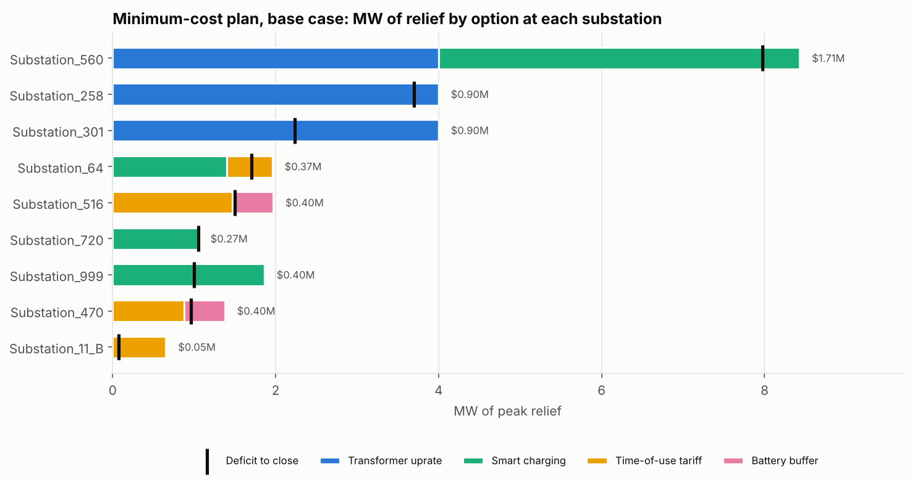
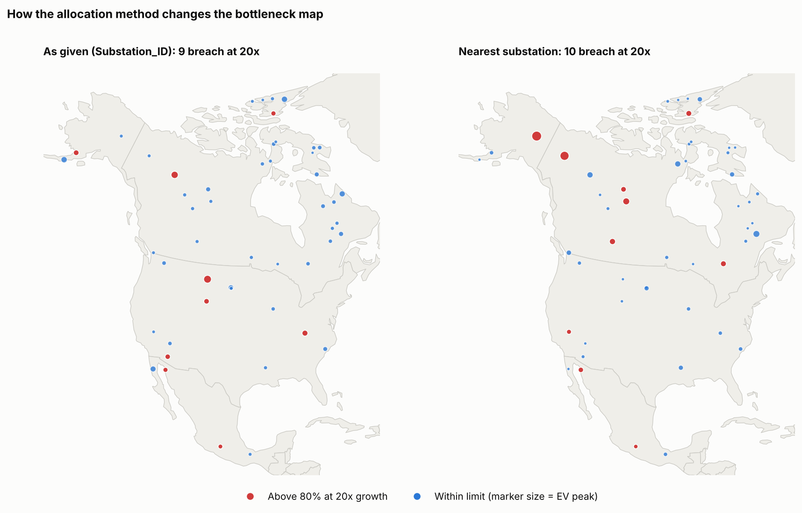

# EV Grid Capacity Planning

How much electric-vehicle charging can a distribution network take before it needs upgrading, which substations go first, and what's the cheapest way to keep them within limits?

I worked through this for a fictional utility, PowerCharge Utilities, using the EV charging, substation and weather data supplied with a project brief that participants were invited to tackle. The brief asked for exploratory analysis, a capacity assessment, network optimisation, geospatial analysis, data transformation and an executive report. The analysis runs across eight notebooks. It starts with a fairly brutal data audit and ends with a costed, prioritised upgrade plan.

**Skills demonstrated:** data quality auditing, scenario modelling, mixed-integer optimisation, geospatial analysis, executive reporting.
**Built with:** Python, pandas, NumPy, SciPy, Matplotlib, Seaborn, GeoPandas, Jupyter.



## The short version

> All capacity and cost figures are scenario-based. They depend on assumed base load, charger ratings, simultaneous charging and planning limits, and should be validated against utility and GIS records before any investment decision.

- **No substation exceeds its planning limit under the modelled assumptions.** EV charging adds 0.1–1.6% to substation peak load. The busiest substation peaks at 67% of capacity, against an 80% planning limit.
- **Headroom runs out unevenly.** The first substation (258) reaches its limit at about 9.4× today's EV load. By 20×, nine substations are over.
- **The risk comes from fast chargers and session volume, not customer type.** Energy per charging session is statistically the same across every segment I tested. What separates the problem substations is DC fast charging: it makes up 81–93% of connected EV power at the at-risk sites, against 17% everywhere else.
- **A mix of fixes is cheaper than reinforcing.** Combining transformer uprates with tariffs, smart charging and small batteries keeps every substation compliant for less than reinforcement alone (see the table below). It stays cheaper even if the non-wire measures deliver only half of what's planned.
- **The answer depends heavily on two inputs we don't have.** Those are existing base load, and which substation each charger is actually connected to. I'd fix those before spending anything beyond the no-regret items ($4.4M across 6 substations).

| EV growth | Within limit | Above limit | Overloaded |
|---|---:|---:|---:|
| Today | 50 | 0 | 0 |
| 5× | 50 | 0 | 0 |
| 10× | 49 | 1 | 0 |
| 20× | 41 | 9 | 0 |
| 40× | 24 | 21 | 5 |

| Scenario | Reinforcement only | Optimised plan | Saving |
|---|---:|---:|---:|
| Base case (65% base load) | $9.0M | $5.4M | $3.6M (40%) |
| Robust case (70% base load) | $18.9M | $12.4M | $6.5M (35%) |

## Beyond the brief

The brief listed Python, NumPy, pandas, Matplotlib, Seaborn, GeoPandas and Jupyter. I went further in four places:

- **Data audit before analysis.** The data had defects that would have changed the conclusions (403 duplicate rows, a duplicated substation ID, contradictory weather labels, impossible charger-to-substation links), so I logged and resolved each one before modelling.
- **Stress-tested assumptions.** Base load, charger ratings, simultaneity and the planning limit are varied across 45 combinations to see which answers survive.
- **A real optimiser.** The brief asked for "optimization algorithms", so I used a mixed-integer program (`scipy.optimize.milp`) to choose between wire and non-wire fixes site by site, and produced a budget frontier.
- **Challenging the data's own geography.** Mapping the data exposed the charger links as physically implausible, so I ran a what-if on reallocating them (notebook 07).

## Data

Three CSVs came with the case study, all in `data/raw/`:

| File | What's in it | Rows |
|---|---|---|
| `ev_distribution_dataset.csv` | Charging events: time, area, customer type, kWh, station location and charger type, EV type, charging habit, number of EVs, substation | 500 (97 after dedup) |
| `geospatial_dataset.csv` | Substations: location and capacity (MW) | 50 |
| `weather_dataset.csv` | Temperature, precipitation and conditions for each event | 97 |

The brief labels the capacity column "Transmission Line Capacity (MW)". I treat it as each substation's capacity, since there is one value per substation and no line-level data.

I found several problems in the data, and they shaped everything downstream. They're all logged in [`reports/data_quality_log.csv`](reports/data_quality_log.csv):

- **403 of the 500 EV rows are exact copies.** Left in, they would have made some substations look up to 14× busier than they are.
- **`Substation_11` appears twice**, with different locations and capacities. I split it into two assets and assigned events to the nearer one.
- **The weather labels don't match the temperatures.** Every "Snowy" reading is above 2 °C, and half are above 25 °C. I used temperature and rainfall and ignored the label.
- **Demand is in kWh but capacity is in MW.** You can't compare energy with power directly, so this needed an explicit model (notebook 04).
- **The charger-to-substation links can't be physically right.** None of the 97 stations is linked to its nearest substation, and the typical link is about 2,700 km long. I only caught this when I mapped the data (notebook 07).

## How I approached it

| | Notebook | What it does |
|---|---|---|
| 01 | [Data audit](notebooks/01_setup_and_data_audit.ipynb) | Profile, check keys and joins, log every issue with a decision |
| 02 | [Transformation](notebooks/02_data_transformation.ipynb) | Apply the fixes, build one clean event table, engineer features, run validation checks |
| 03 | [EDA](notebooks/03_exploratory_analysis.ipynb) | Timing, segments and weather, with significance tests rather than eyeballing |
| 04 | [Capacity assessment](notebooks/04_capacity_assessment.ipynb) | Convert charging to peak MW, test growth scenarios, find which assumptions move the answer |
| 05 | [Bottlenecks](notebooks/05_bottleneck_identification.ipynb) | Breach probability across 45 assumption combinations, risk score, tiered register |
| 06 | [Optimisation](notebooks/06_network_optimization.ipynb) | Mixed-integer program choosing between wire and non-wire fixes, budget frontier |
| 07 | [Geospatial](notebooks/07_geospatial_analysis.ipynb) | GeoPandas maps, clustering test, and a what-if on the charger-to-substation links |
| 08 | [Executive report](notebooks/08_executive_report.ipynb) | Findings, recommendations, risks, one-page summary |

A few choices worth explaining:

**Scenarios instead of a forecast.** The data covers 38 days with no visible trend, so any forecast would be made up. Instead, each substation gets a *breaking multiple*: how many times today's EV load it can take before reaching 80%. Each upgrade then gets a trigger, so it's funded when measured load reaches that point.

**Assumptions are stress-tested.** Charger ratings, how many chargers run at the same moment, existing base load, and the planning limit all sit in one place and get varied. Base load turned out to matter most: moving it from 55% to 75% takes the number of at-risk substations at 10× growth from 0 to 18.

**The bottleneck list has to hold up.** A ranking that flips when one weight changes isn't something to put capital behind. The tiers are based on how often a substation breaches across 45 assumption combinations, and the ranking holds up under four alternative weightings (rank correlation ≥ 0.95).

**Cheap fixes come first, when they're enough.** Tariffs and smart charging cost little per MW but can only shift part of the load. Transformer uprates are expensive but deliver a guaranteed block of capacity. A rule of thumb can't balance that trade-off, so the optimiser (`scipy.optimize.milp`) decides site by site.





## What I'd recommend

1. **Validate the data first** (0–3 months). Reconcile charger-to-substation connectivity against the GIS, and pull 12 months of SCADA peak load for the at-risk substations.
2. **Approve the no-regret package ($4.4M, 6 substations) in principle.** These actions are needed under every base-load assumption I tested. Release the money once step 1 confirms the connections.
3. **Pilot time-of-use tariffs and smart charging** at the substations where the plan relies on them, to see whether they deliver the assumed 10–25% peak reduction.
4. **Review new DC fast-charger connections** at at-risk substations before approving them.
5. **Fund the rest on triggers, not dates.** The full robust plan is $12.4M if base load turns out higher.
6. **Track EV peak per substation** against its trigger on a monthly dashboard.

## Limitations

- 97 charging events over 38 days is enough to describe patterns, but not to forecast growth.
- Base load is assumed, not measured, so absolute utilisation figures are modelled estimates.
- The coordinates span most of North America, so the maps show relative patterns rather than a real service area.
- Unit costs are indicative. They're in one table in notebook 06, so real figures can be dropped in and the plan re-run.
- Only thermal capacity is modelled. Voltage drop on long feeders would need a power-flow model (pandapower would be my next step).

## Running it

```bash
git clone https://github.com/Irfat-code/ev-grid-capacity-planning.git
cd ev-grid-capacity-planning

python -m venv .venv
source .venv/bin/activate        # Windows: .venv\Scripts\activate
pip install -r requirements.txt  # or: conda install -c conda-forge geopandas

jupyter lab
```

Run the notebooks in order, 01 to 08. Each one reads what the previous one saved, so a full run rebuilds every table, chart and the summary page from the raw CSVs.

```
data/raw/          original case-study files
data/external/     Natural Earth country outlines (public domain), used for the maps
data/processed/    cleaned tables, capacity results, risk scores, GeoJSON
notebooks/         01–08
reports/           figures, data-quality log, bottleneck register, upgrade plan, recommendations
src/ev_utils.py    shared helpers, including the capacity model
```

## Licence

[MIT](LICENSE)

---

**Anna Tafri**, Data Analytics Engineer
Portfolio: [tafri-portfolio.netlify.app](https://tafri-portfolio.netlify.app) · GitHub: [Irfat-code](https://github.com/Irfat-code)